# Práctica 3. Viajando en el Tiempo y Corrigiendo el Historial

## 1. Creación del repositorio y primer commit

En esta práctica he utilizado Git Bash y un archivo llamado `calculadora.py` para ir haciendo cambios y ver cómo se guardan en el historial de Git.

Primero configuré `main` como rama por defecto y creé la carpeta del proyecto:

```bash
git config --global init.defaultBranch main
mkdir git-historial-practica
cd git-historial-practica
git init
```

Después creé `calculadora.py` con una función para sumar dos números y guardé esa primera versión con estos comandos:

```bash
git add calculadora.py
git commit -m "C1: Creación de la función sumar."
```

El hash abreviado del primer commit (C1) fue `74a74d9`.

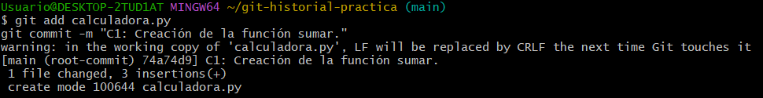

---

## 2. Segundo commit: función restar

Lo siguiente fue añadir al archivo una función para restar. El programa ya tenía las dos funciones:

```python
def sumar(a, b):
    return a + b

def restar(a, b):
    return a - b

print(sumar(5, 3))
print(restar(10, 4))
```

Para guardar esta versión hice el commit utilizando `-a`, que permite incluir los cambios de los archivos que Git ya estaba siguiendo:

```bash
git commit -a -m "C2: Añadida la función restar."
```

El hash abreviado de C2 fue `9489d5a`.

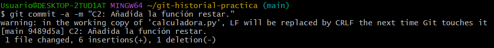

---

## 3. Consulta del historial

Con los dos commits hechos, utilicé este comando para ver qué había cambiado en cada uno:

```bash
git log -p --stat
```

En C2 aparecían **6 líneas añadidas y 1 eliminada**. Con `-p` también pude ver cuáles eran esas líneas.

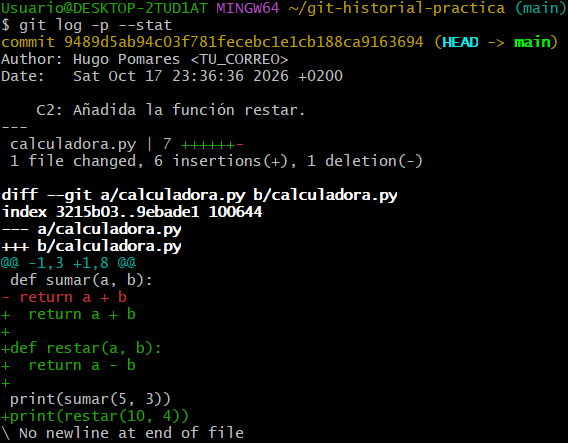

Después probé otra forma de mostrar el historial, esta vez con un commit por línea:

```bash
git log --pretty=format:"%h - %an, %ar : %s"
```

Así se ven los hashes abreviados, mi nombre, el tiempo transcurrido y el mensaje de cada commit, sin tanta información en pantalla.

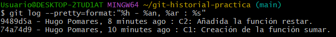

---

## 4. Etiqueta y comparación de versiones

Para marcar C2 como una versión estable creé la etiqueta `v1.0-estable`:

```bash
git tag v1.0-estable
git tag
```

Al comprobar las etiquetas, aparecía `v1.0-estable`.

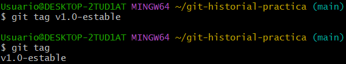

Luego comparé esa versión con C1 usando el hash del primer commit:

```bash
git diff 74a74d9 v1.0-estable
```

En la comparación se veía que se había añadido la función `restar` junto con su línea de prueba.

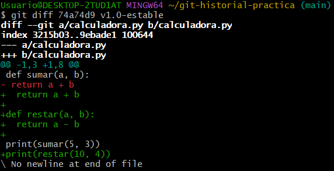

---

## 5. Descartar cambios con git restore

Para probar `git restore` añadí este comentario al principio de `calculadora.py`:

```python
# ¡ESTE COMENTARIO DEBE BORRARSE!
```

Al ejecutar `git status`, Git indicaba que el archivo estaba modificado.

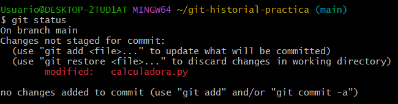

Como todavía no había guardado ese cambio en un commit, pude quitarlo con:

```bash
git restore calculadora.py
git status
```

El comentario desapareció y el repositorio volvió a estar limpio (`working tree clean`).

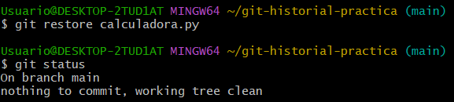

---

## 6. Prueba con el Staging Area

Volví a poner el comentario erróneo, pero esta vez añadí el archivo al staging:

```bash
git add calculadora.py
git status
```

En el resultado, `calculadora.py` aparecía en `Changes to be committed`, es decir, preparado para el siguiente commit.

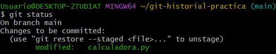

Después ejecuté:

```bash
git restore --staged calculadora.py
git status
```

El archivo salió del staging, aunque el comentario seguía estando en el archivo. Con esto pude comprobar que `--staged` no borra el cambio, solo lo quita de los cambios preparados para confirmar.

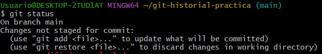

Por último, utilicé `git restore calculadora.py` para quitar el comentario y dejarlo todo como antes.

---

## 7. Commit C3 y git revert

Después añadí `multiplicar`, pero con un error a propósito: en vez de multiplicar los dos números, los sumaba.

```python
def multiplicar(a, b):
    return a + b
```

Guardé el error con este commit:

```bash
git commit -a -m "C3: Añadida la función multiplicar (con un bug conceptual)."
```

El hash abreviado de C3 fue `7e217a4`.

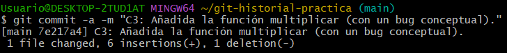

Para deshacer C3 sin eliminarlo del historial utilicé:

```bash
git revert HEAD --no-edit
git log --pretty=oneline -3
```

Git creó un commit nuevo que deshacía los cambios de C3. En el historial se seguía viendo el commit con el fallo y, por encima, el de `Revert`.

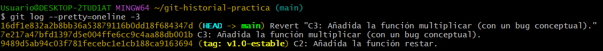

---

## 8. Corregir el último commit con amend

Una vez hecho el `revert`, volví a añadir `multiplicar`, esta vez utilizando la operación correcta:

```python
def multiplicar(a, b):
    return a * b
```

Después ejecuté:

```bash
git add calculadora.py
git commit --amend -m "C4: Revertido C3 y añadida correctamente la función multiplicar."
```

Con `--amend` modifiqué el último commit para que también incluyese la función correcta. Su hash cambió: antes empezaba por `16df1e8` y después pasó a ser `10ec0f0`.

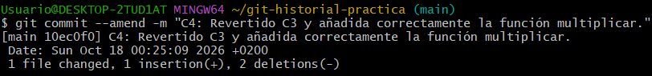

Al consultar el historial final se podían ver C4, C3 y C2, con `HEAD` apuntando a `main`. La etiqueta `v1.0-estable` seguía en C2.

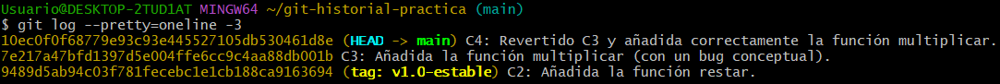

---

## 9. Ejercicios de autoevaluación

### 1. ¿Cuál es el hash abreviado de C1?

Es `74a74d9`. En ese commit solo estaba creada la función `sumar`.

### 2. ¿Cómo iría al commit anterior a v1.0-estable en modo desacoplado?

El comando sería:

```bash
git switch --detach v1.0-estable~1
```

La etiqueta apunta a C2 y `~1` indica el commit anterior, que es C1. `--detach` permite situarse en ese commit sin cambiar la rama `main`.

### 3. ¿Qué habría pasado usando reset --hard en vez de revert?

Si hubiese utilizado `git reset --hard 9489d5a`, la rama habría vuelto a C2 y C3 dejaría de aparecer en su historial normal. Si el repositorio estuviera compartido y esos cambios ya se hubiesen subido, podría dar problemas a otros compañeros al intentar sincronizar sus trabajos.

Con `git revert` es diferente, porque no se elimina C3: se crea otro commit que deshace lo que hizo.

### 4. ¿A qué apunta HEAD al terminar?

Al terminar, `HEAD` apunta a la rama `main`, no está en modo `Detached HEAD`. En la última captura se ve `HEAD -> main`.

---

## 10. Resultado final

Con estas pruebas he visto cómo consultar versiones anteriores, comparar cambios y corregir errores en Git. Lo que más me ha aclarado la práctica es la diferencia entre descartar un cambio sin confirmar, deshacer un commit dejando constancia y modificar el último commit con `--amend`.
